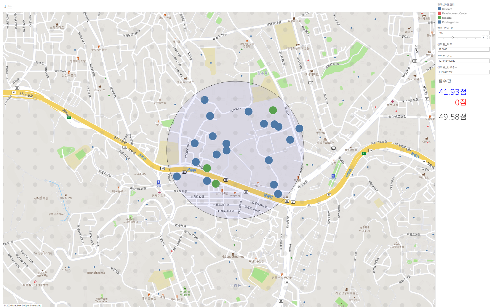

# 곽재양

문제를 정리하고, 사람과 데이터를 연결해 실행합니다.

[블로그](https://queryjaeyang.tistory.com/) · [이메일](mailto:kwakjaeyang@naver.com)

## 프로젝트

| 프로젝트 | 역할과 결과 | 이미지 |
| :--- | :--- | :---: |
| **UpSKale** 기업연계 빛 도면 최적화 2026 · 5인 팀 | 조장으로 우선순위·역할·멘토 소통을 조율하고 발표를 총괄했습니다. 팀이 프로토타입을 구현하고 최우수상을 공동 수상했습니다. | 이미지 추가 예정 |
| **서울시 아동 발달센터 입지 분석** 개인 프로젝트 · 2026 | 입지 점수와 가중치를 설계하고 Tableau 대시보드를 구현했습니다. 발표에서 대용량 데이터에 따른 응답 지연을 확인했습니다. |  |
| **Gamefound 모금액 예측** 머신러닝 · 2026 · 5인 팀 | 데이터·댓글 수집과 변수 검토, 발표를 맡았습니다. 팀 발표의 XGBoost 모델은 R² 0.89를 기록했습니다. | 이미지 추가 예정 |
| **콘서트 영상 장애물 제거** 딥러닝 · 2026 · 5인 팀 | 조장으로 방향과 일정을 조율하고 결과를 발표했습니다. 팀은 일부 장면의 복원 개선과 탐지·복원 한계를 확인했습니다. | 이미지 추가 예정 |
| **상담을 잇담** 서비스 기획 · 2018 · 5인 팀 | 상담사·내담자 연결 서비스의 시장 조사와 페이지 기획, 팀 간 협업에 참여했습니다. 초기 산출물 제작 후 사업은 중단되었습니다. | 이미지 추가 예정 |

<!-- 이미지를 추가하려면 파일을 assets 폴더에 넣고, 표의 '이미지 추가 예정'을 아래 예시로 바꿔 주세요.

-->

## 경험과 도구

| 구분 | 내용 |
| :--- | :--- |
| **현장 경험** | 지앤선 아동발달센터 사회성 치료사 (2023–2025) · 치료 및 부모 상담, 운영 문서와 협업 체계 정비 |
| **데이터** | Python · SQL · Pandas · NumPy · Tableau |
| **AI** | scikit-learn · PyTorch · XGBoost · Google Colab |
| **협업** | Notion · FigJam · Google Workspace · Git · GitHub |
| **교육** | SK Planet T Academy 데이터 분석·ML·DL 교육 940시간 이수 (2026) |
| **학력** | 성균관대학교 심리학과·아동청소년학과 학사 및 아동청소년학과 석사 · 서울사이버대학교 특수심리치료학과 학사 |

## 링크와 추가 확인

- [Gamefound 팀 프로젝트 저장소](https://github.com/karls-seon/Asac-ML-Team4) · [블로그](https://queryjaeyang.tistory.com/)
- 프로젝트별 이미지와 상세 자료는 공개 가능 여부를 확인한 뒤 추가할 예정입니다.
- Gamefound 모델의 평가 데이터와 평가 방식, UpSKale에서 직접 작성한 코드의 구체적인 범위는 추가 확인이 필요합니다.
