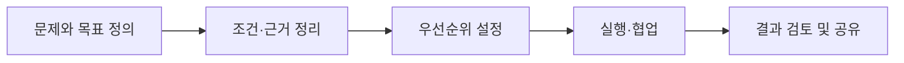

<!--
GitHub profile README | Kwak Jaeyang
Design: editorial + project case cards + selected evidence
5 selected projects only. No therapy-program improvement case.
To activate images, upload real screenshots to assets/ and remove the surrounding HTML comments.
Publish only assets you have permission to share.
-->

KWAK JAEYANG / SELECTED PROJECTS / 2026

# 곽재양

### 문제를 구조화하고, 사람과 기술을 연결합니다.

**Project Management** · **Data Analytics** · **AI**

심리학 기반의 현장 경험에서 출발해 서비스 기획과 데이터·AI 프로젝트로 활동 영역을 넓혔습니다.  
문제의 조건을 정리하고, 협업의 우선순위를 조율하며, 실험과 실행의 결과를 이해하기 쉽게 전달하는 일에 관심이 있습니다.

---

## Portfolio at a Glance

| **05** | **약 127,920** | **최우수상** |
| :---: | :---: | :---: |
| 이력서에서 선정한 프로젝트 | 서울시 입지 분석 후보 격자 | 2026 기업 Match 팀 공동 수상 |
| 기획 · 분석 · ML · DL | 개인 데이터 분석 | UpSKale 5인 팀 |

각 프로젝트에서 개인 기여와 팀의 결과를 구분해 작성했습니다.

---

## Featured Work

### 01 / UpSKale — CAL 빛 도면 최적화

ENTERPRISE AI · 2026.07.20–10.02 · SK하이닉스 기업연계 · 5인 팀 / PM

<table>
<tr>
<td width="39%" valign="top">

<strong>THE PROJECT</strong>

CAL 공정의 빛 도면 최적화에 딥러닝을 적용한 프로토타입 개발

<strong>담당</strong> 팀장(PM) · 진행 및 협업 조율 · 최종 발표

<!--
실제 FigJam 보드 또는 공개 가능한 실험 결과 화면을 추가하세요.

-->

<strong>RESULT</strong> 기업 Match 팀 프로젝트 <strong>최우수상 공동 수상</strong>

</td>
<td valign="top">

<strong>내가 맡은 일</strong>

<ul>
<li>과업 우선순위 결정, 역할 분배, 일정 및 진행 보고 관리</li>
<li>팀원의 작업 상황에 따른 인력 배치와 마감 조율</li>
<li>원격 멘토링을 위한 FigJam 보드 구성 및 기술적 질문·피드백 정리</li>
<li>발표 개요와 시각 자료 구성, 최종 발표 및 일부 코드 작업</li>
</ul>

<strong>팀 결과 및 한계</strong>

선량 분포를 계산·평가하는 연산 파이프라인과 딥러닝 기반 동작 프로토타입을 구성했습니다. 최종 결과에서는 모델 성능의 한계와 개선 방향도 확인했습니다.

Python · PyTorch · Google Colab · FigJam · GitHub

</td>
</tr>
</table>

### 02 / 서울시 아동 발달센터 입지 분석

PERSONAL DATA ANALYTICS · 2026.05.04–05.18 · 개인 프로젝트

<table>
<tr>
<td width="39%" valign="top">

<strong>THE PROJECT</strong>

아동 인구 및 주변 시설 데이터를 활용해 후보지별 입지 조건을 비교하는 Tableau 대시보드

<strong>약 127,920개</strong> 서울시 100m 격자 후보지

<!--
실제 Tableau 대시보드 스크린샷을 추가하세요.

-->

</td>
<td valign="top">

<strong>내가 맡은 일</strong>

<ul>
<li>입지 평가 문제 정의, 평가 항목과 가중치 설계</li>
<li>Kakao Map API와 공공데이터 수집 및 정리</li>
<li>후보지별 반경 내 시설의 가점·감점 및 총점 계산</li>
<li>Tableau 인터랙티브 대시보드 구현과 발표</li>
</ul>

<strong>결과 및 한계</strong>

후보지별 점수와 그 근거를 비교할 수 있는 대시보드를 구현했습니다. 발표 시 대용량 데이터로 응답 지연이 발생해 성능 개선 필요성도 확인했습니다.

Python · Pandas · NumPy · GeoPandas · Kakao Map API · Tableau

</td>
</tr>
</table>

---

## More Projects

<table>
<tr>
<td width="50%" valign="top">

03 / MACHINE LEARNING

<h3>Gamefound 보드게임 최종 모금액 예측</h3>

2026.05.20–06.15 · 5인 팀

<!--

-->

<strong>문제</strong> 펀딩 프로젝트의 기본 정보와 초기 반응을 활용해 최종 모금액 예측

<strong>내 역할</strong> Gamefound 및 댓글 데이터 크롤링, 통화 단위 통일 제안, 변수 활용 방향 검토, 일정·발표 조율 및 최종 발표

<strong>팀 발표 결과</strong> XGBoost <strong>R² 0.89</strong>, MAE 19,750

발표 자료 기준 수치로, 평가 조건과 재현성은 추가 검증이 필요합니다.

Python · Pandas · scikit-learn · XGBoost

<a href="https://github.com/karls-seon/Asac-ML-Team4">팀 프로젝트 저장소</a>

</td>
<td width="50%" valign="top">

04 / DEEP LEARNING

<h3>콘서트 영상 장애물 제거</h3>

2026.06–07 · 5인 팀 / 조장

<!--

-->

<strong>문제</strong> Video Inpainting으로 콘서트 영상의 관람 방해 요소 제거

<strong>내 역할</strong> 프로젝트 방향 설정, 역할·일정 조율, 모델별 비교 결과를 문제·실험·결과 순서로 구조화하고 최종 발표

<strong>팀 결과 및 한계</strong> 객체 탐지 → 마스킹 → 영상 복원의 파이프라인을 탐색했습니다. 일부 장면에서 개선을 확인했지만 가림 구간과 탐지 오탐·누락 문제는 남았습니다.

YOLO · SAM2 · DiffuEraser (팀 공통 활용)

</td>
</tr>
</table>

---

### 05 / 상담을 잇담 — 상담사·내담자 연결 서비스

SERVICE PLANNING · 2018.01.10–11.14 · ㈜상담플래닛

<table>
<tr>
<td width="39%" valign="top">

<strong>THE PROJECT</strong>

상담사와 내담자를 연결하는 플랫폼의 초기 서비스 기획 및 콘텐츠 제작

<!--
공개 가능한 당시 서비스 화면 또는 기획 자료를 추가하세요.

-->

<a href="https://woonginc.wixsite.com/woong-inc">당시 프로젝트 홈페이지</a>

</td>
<td valign="top">

<strong>내가 맡은 일</strong>

<ul>
<li>대표의 아이디어를 서비스 흐름과 사용자 페이지 기획으로 구체화</li>
<li>상담시장 조사, 상담센터 연락·방문 및 상담사 인터뷰</li>
<li>상담사 소개 페이지와 관련 콘텐츠 기획</li>
<li>디자인·영상팀 협업, 촬영 과정 조율 및 외부 개발팀 연결</li>
</ul>

<strong>산출물과 한계</strong>

홈페이지와 상담사 소개 영상 등 초기 산출물 제작에 참여했습니다. 이후 사업은 중단되었으며, 고객 확보 및 매출 성과는 확인되지 않았습니다.

Service Planning · UX Planning · Stakeholder Communication

</td>
</tr>
</table>

---

## How I Work

프로젝트 성과는 팀 전체의 결과인지, 직접 수행한 부분인지 구분해 기술합니다.

---

## Skills and Tools

| 영역 | 사용 도구 |
| :--- | :--- |
| **기획·협업** | Notion, FigJam, Google Workspace, Excel, PowerPoint, Canva |
| **데이터 분석** | Python, Pandas, NumPy, SQL, Tableau |
| **ML / DL** | scikit-learn, XGBoost, PyTorch, Google Colab |
| **개발 환경** | Git, GitHub, AWS |

## Background

- **2026** · SK Planet T Academy 데이터 분석·ML·DL 교육, 총 940시간
- **2023–2025** · 지앤선 아동발달센터 사회성 치료사
- **2023** · 서울사이버대학교 특수심리치료학과 졸업
- **2019** · 성균관대학교 심리학과 및 아동·청소년학과 졸업

---

프로젝트 상세 코드와 자료는 공개 가능 범위를 확인해 순차적으로 연결합니다.

[Technical Notes and Blog](https://queryjaeyang.tistory.com/)
