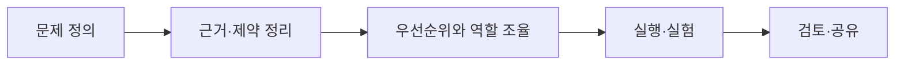

<!--
  GitHub profile README / Kwak Jaeyang
  Design: visual case-study (no animated banner, no typing SVG)
  Add real project screenshots under assets/ and uncomment each  line.
  Use only images you have permission to publish; remove personal/company confidential data.
-->

KWAK JAEYANG · PROJECT PORTFOLIO · 2026

# 곽재양

### 문제를 구조화하고, 사람과 기술을 연결합니다.

**Project Management** · **Data Analytics** · **AI Projects**

심리학 기반의 현장 경험에서 출발해 데이터 분석과 AI 프로젝트로 활동 영역을 확장했습니다.  
문제의 목표와 제약을 정리하고, 실행 우선순위와 협업 흐름을 설계하며, 결과를 이해하기 쉽게 전달하는 일에 관심이 있습니다.

---

## At a Glance

| **5인 팀** | **약 12.8만 개** | **48 → 26개** |
| :---: | :---: | :---: |
| UpSKale 기업연계 프로젝트 | 서울시 입지 후보 격자 | 치료 프로그램 주제 재구성 |
| PM · 발표 총괄 | 개인 분석 · 대시보드 구현 | 4인 치료사 팀의 운영 개선 |

---

## Selected Projects

### 01. UpSKale — CAL 빛 도면 최적화

SK하이닉스 기업연계 · 딥러닝 · 2026.07.20–10.02

<table>
<tr>
<td width="39%" valign="top">

<strong>PROJECT SNAPSHOT</strong>

CAL 공정의 빛 도면 최적화에 딥러닝을 적용한 프로토타입 개발

<strong>5명</strong> · 팀 프로젝트 
<strong>PM</strong> · 과업·협업 조율

<!-- 실제 스크린샷을 assets/01-upskale-figjam.png로 저장한 다음 아래 줄의 주석을 제거하세요.

-->

2026 기업 Match 팀 프로젝트 최우수상 공동 수상

</td>
<td valign="top">

<strong>내가 담당한 일</strong>

<ul>
<li>과업 우선순위 설정과 역할·일정 분배</li>
<li>진행 보고 취합 및 인력 배치 조율</li>
<li>FigJam 원격 멘토링 보드 구성과 기술 커뮤니케이션</li>
<li>최종 발표 흐름 구성 및 발표, 일부 코드 작업</li>
</ul>

<strong>팀 결과와 한계</strong>

선량 분포 계산·평가 파이프라인과 딥러닝 기반 동작 프로토타입을 구성하고, 모델 성능의 한계와 개선 방향을 검토했습니다.

Python · PyTorch · Colab · FigJam · GitHub

</td>
</tr>
</table>

### 02. 서울시 아동 발달센터 입지 분석

개인 데이터 분석 · 2026.05.04–05.18

<table>
<tr>
<td width="39%" valign="top">

<strong>PROJECT SNAPSHOT</strong>

아동 인구·발달센터·주변 시설 데이터를 반영해 입지 조건을 점수로 비교하는 대시보드

<strong>약 127,920개</strong> 
서울시 100m 격자 후보지

</td>
<td valign="top">

<strong>내가 담당한 일</strong>

<ul>
<li>문제 정의 및 입지 평가 항목·가중치 설계</li>
<li>Kakao Map API·공공데이터 수집 및 정리</li>
<li>후보지별 반경 내 시설의 가감점 계산</li>
<li>Tableau 인터랙티브 대시보드 구현과 발표</li>
</ul>

<strong>결과와 한계</strong>

후보지별 점수와 가감점 근거를 확인하는 대시보드를 완성했습니다. 발표 중 대용량 데이터로 응답 지연이 발생해 성능 개선 과제를 확인했습니다.

Python · Pandas · NumPy · Kakao Map API · Tableau

</td>
</tr>
</table>

---

## More Data and AI Projects

<table>
<tr>
<td width="50%" valign="top">

<strong>03 / Gamefound</strong>

<h3>보드게임 최종 모금액 예측</h3>

팀 ML 프로젝트 · 5명 · 2026.05.20–06.15

<!--

-->

Gamefound 데이터 수집, 통화 단위 통일 제안, 변수 활용 여부 검토, 일정·발표 조율 및 최종 발표에 참여했습니다.

<strong>팀 발표 결과</strong> · XGBoost R² 0.89

발표 자료 기준 수치. 평가 조건과 재현 가능성은 별도 확인 필요.

Python · Pandas · scikit-learn · XGBoost

</td>
<td width="50%" valign="top">

<strong>04 / Concert Video</strong>

<h3>콘서트 영상 장애물 제거</h3>

팀 DL 프로젝트 · 5명 · 2026.06–07

<!--

-->

조장으로서 프로젝트 방향, 업무·일정을 조율하고 탐지·마스킹·영상 복원 결과를 문제·실험·결과 흐름으로 정리해 발표했습니다.

<strong>팀 결과</strong> · 일부 장면의 복원 개선 확인. 완전 가림 구간과 탐지 오탐·누락 문제도 확인.

YOLO · SAM2 · DiffuEraser (팀 활용 기술)

</td>
</tr>
</table>

---

## Planning and Operations Experience

### 05. 치료 프로그램 및 협업 체계 개선

지앤선 아동발달센터 · 정규직 사회성 치료사 · 2023.01–2025.12

| **48 → 26개** | **4명** |
| :---: | :---: |
| 중복 주제를 통합해 치료 프로그램 주제 체계를 재구성 | 치료사 공동 문서를 Google Drive·Sheets로 전환 |

- 아동별 사회성 치료 프로그램 계획·그룹 회기 운영·부모 상담 연계
- 치료 프로그램의 중복 주제 정리 및 순환 운영 체계 구성
- 공동 문서의 폴더·파일명 규칙 정비와 실시간 협업 방식 도입

<!-- 개인정보를 비식별 처리한 운영 구조 비교 그림을 올린 후 주석을 제거하세요.

-->

48 → 26은 치료 회기 수 감소가 아니라 프로그램 **주제 체계** 개편을 의미합니다.

### 06. 상담을 잇담 — 서비스 초기 기획

㈜상담플래닛 · 2018.01–11

- 상담사·내담자 연결 플랫폼의 서비스 흐름 및 상담사 소개 페이지 기획
- 상담시장 조사, 상담센터 연락·방문 및 인터뷰
- 디자인·영상팀 협업, 외부 개발팀 연결 및 일정 조율
- 홈페이지·인터뷰 영상 등 초기 산출물 제작 참여

[당시 프로젝트 홈페이지](https://woonginc.wixsite.com/woong-inc)

이후 사업은 중단되었으며 고객 확보·매출 성과는 확인되지 않았습니다.

---

## How I Approach Projects

현장 운영, 서비스 기획, 데이터 분석, 딥러닝 프로젝트에서 공통으로 사용해 온 업무 접근 방식

---

## Skills and Tools

| 영역 | 사용한 도구 |
| :--- | :--- |
| **Planning and Collaboration** | Notion, FigJam, Google Workspace, Excel, PowerPoint, Canva |
| **Data Analytics** | Python, Pandas, NumPy, SQL, Tableau |
| **ML / DL** | scikit-learn, XGBoost, PyTorch, Google Colab |
| **Development** | Git, GitHub, AWS |

## Background

- **2026** · SK Planet T Academy 데이터 분석·ML·DL 과정, 총 940시간 수료
- **2023–2025** · 지앤선 아동발달센터 사회성 치료사
- **2023** · 서울사이버대학교 특수심리치료학과 졸업
- **2019** · 성균관대학교 심리학과 및 아동·청소년학과 졸업

---

팀 결과와 개인 기여를 구분해 작성했습니다. 관련 코드·발표 자료·프로젝트 이미지는 공개 가능 범위를 확인한 뒤 연결합니다.

[Technical Notes and Blog](https://queryjaeyang.tistory.com/)
